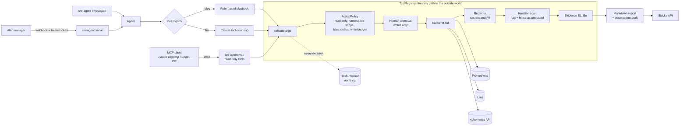

# Architecture

## Request flow

1. Alertmanager posts a firing alert. Duplicate alerts within the dedupe
   window are skipped, and investigations run on a bounded worker pool.
2. The Agent creates an `Investigation` and a fresh `ToolRegistry` with its own
   policy, so the write budget is per investigation.
3. The investigator gathers evidence. The rule-based one runs a fixed playbook;
   the LLM one decides which tools to call.
4. Each tool result is redacted, screened for injected instructions, numbered
   (`E1`, `E2`, ...) and audit-logged before anyone sees it.
5. The finding must cite evidence ids. Ids the model invents are dropped and
   counted as hallucinated citations.
6. The playbook maps the root cause to a next step. If that step is a write
   tool, it goes back through the registry: blocked in read-only mode,
   otherwise it needs a human approval.
7. The report is stored, exposed over the API and optionally posted to Slack.

## Design choices

| Choice | Why |
|---|---|
| Fixed root-cause taxonomy | Makes findings comparable and evaluations scoreable; maps directly to a remediation playbook |
| Abstract "signals" instead of raw PromQL in prompts | The model asks for `error_rate`, not a query string, so it cannot run arbitrary PromQL; queries live in `signals.yaml` |
| Log summarisation (normalised top messages) | The model reasons about which errors dominate, not 5,000 raw lines; this cuts tokens and resists log flooding |
| Same registry for rules, LLM and MCP | One enforcement point; guardrails cannot drift between entry points |
| Evidence ids | Every claim in a report is traceable to a specific tool call in the audit log |
